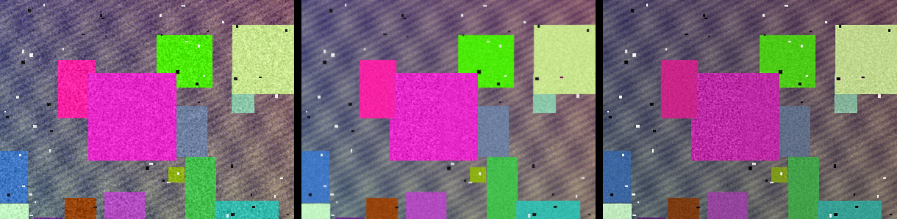

# Nítida 📷

App de cámara para Android que **fusiona una ráfaga de fotos** para quitar ruido y aplica **modos con ajustes propios** (Gym, Noche, Selfie, Exterior...). Todo se procesa en el móvil, sin internet y sin modelos de IA: solo procesado de imagen clásico.

Pensada para sacar más partido a cámaras de gama media (en concreto, la de un Samsung Galaxy A53).

## Qué hace

- **Ráfaga + fusión**: hace de 1 a 8 fotos seguidas, las alinea y las promedia. El ruido baja mucho (sobre todo en interiores y de noche) sin perder detalle.
- **Sin fantasmas**: si algo se mueve entre fotos (una persona, una mancuerna), esa zona se queda de una sola foto en vez de salir duplicada.
- **Modos** con valores de fábrica, retocables y guardados:

| Modo | Para qué | Ajustes principales |
|---|---|---|
| Natural | Uso general | Ráfaga de 4, algo de nitidez |
| **Gym** | Focos fuertes, espejos, brillos en la piel | −0,7 EV al disparar, altas luces −40, contraste +25, nitidez, viñeta |
| Noche | Poca luz | Ráfaga de 8, sombras +30 |
| Selfie | Cámara frontal | Tono cálido, luz suave |
| Exterior | Sol y cielo | −0,3 EV, cielo recuperado, colores más vivos |

- **Formatos de foto** con guía en el visor y opción de guardar al tamaño exacto para redes:

| Formato | Proporción | Medida | Dónde se usa |
|---|---|---|---|
| Completo | 3:4 | 1080 × 1440 | Todo el sensor; la cuadrícula del perfil de Instagram la muestra sin recortar |
| Historia | 9:16 | 1080 × 1920 | Historias y Reels (Instagram, Facebook), TikTok, YouTube Shorts, estados de WhatsApp |
| Publicación | 4:5 | 1080 × 1350 | Feed de Instagram, Facebook y LinkedIn |
| Cuadrado | 1:1 | 1080 × 1080 | Fotos de perfil, carruseles, productos |
| Pinterest | 2:3 | 1000 × 1500 | Pines, carteles verticales |
| Horizontal | 16:9 | 1920 × 1080 | Miniaturas de YouTube, X/Twitter, fondos de PC |

- **Panel de ajustes**: fotos de la ráfaga, exposición (EV), brillo, contraste, altas luces, sombras, saturación, calidez, nitidez y viñeta.
- **Vista previa aproximada** del modo en el visor (Android 12+).
- **Antes / después**: tras cada foto, mantén pulsado para ver la original.
- Toca para enfocar, cámara frontal y trasera, selfies en espejo opcionales.
- Guarda en `Imágenes/Nitida` (no pide permiso de almacenamiento).

## Cómo funciona la fusión

Es una versión simplificada de la idea del HDR+ de Google, escrita desde cero en Java (`core/BurstMerger.java`):

1. **Referencia**: de la ráfaga se elige la foto más nítida (la menos movida).
2. **Alineado de grueso a fino**: pirámide de luminancia (1/16 → 1/4 → resolución completa) para el desplazamiento global; después se afina por **teselas de 256 px**, lo que corrige también pequeños giros de la mano. Entre teselas el desplazamiento se interpola.
3. **Fusión robusta**: en cada bloque de 4×4 se compara el **color** de la foto alineada con la referencia. El umbral se adapta a la textura del bloque y al nivel de ruido medido. Si coinciden, se promedia; si no, el bloque pierde peso.
4. **Ajustes**: máscara de enfoque (ahora se puede enfocar sin que salga grano), curva tonal siempre creciente, saturación, calidez y viñeta (`core/PhotoTuner.java`).

Con ráfagas sintéticas (escena + temblor de mano + ruido) los tests dan:

| Prueba | 1 foto | Fusionada |
|---|---|---|
| 6 fotos, mano movida | 28,2 dB | **35,9 dB** |
| 6 fotos, movida y girada | 28,1 dB | **33,6 dB** |
| Exposición distinta entre fotos | 28,2 dB | **34,9 dB** |


*Escena de prueba sintética: una foto con ruido · 6 fotos fusionadas (el cuadrado que se movía no deja rastro) · fusionada + modo Gym.*

## Instalar

**APK listo:** cada cambio en `main` lo compila GitHub Actions y lo publica en [Releases](https://github.com/KrmIvan/nitida-cam/releases/latest). Enlace directo al último APK:
https://github.com/KrmIvan/nitida-cam/releases/latest/download/nitida.apk

Para instalarlo hay que permitir "instalar apps de origen desconocido" en el navegador o el gestor de archivos.

**Compilar tú mismo:** abrir la carpeta con Android Studio, conectar el móvil con depuración USB y pulsar ▶ Run. O bien `./gradlew assembleDebug`.

Requisitos: Android 10 o superior.

## Estructura

```
app/src/main/java/com/ivanjulval/nitida/
├── core/                  ← Java puro, sin Android (se prueba en la JVM)
│   ├── BurstMerger.java   alineado + fusión robusta
│   ├── PhotoTuner.java    nitidez, curva tonal, color, viñeta
│   ├── ImageOps.java      giro, espejo, puntuación de nitidez
│   └── Adjustments.java   valores de un modo
├── MainActivity.kt        cámara (CameraX), interfaz, antes/después
├── BurstCapture.kt        ráfaga de JPEG en memoria
├── BurstProcessor.kt      referencia → fusión → ajustes → giro
├── Presets.kt             modos y guardado de retoques
├── AdjustmentsSheet.kt    panel de deslizadores
├── PreviewLook.kt         filtro aproximado del visor
└── PhotoSaver.kt          guardado en la galería (MediaStore)
```

El núcleo de procesado está separado de Android a propósito: se puede probar con JUnit en cualquier PC (`./gradlew testDebugUnitTest`).

## Limitaciones e ideas

- Trabaja con el JPEG que da la cámara, no con RAW: Samsung ya aplica su procesado y no se puede saltar desde una app normal.
- La ráfaga se hace foto a foto (unas 2-4 por segundo): hay que estar quieto un momento.
- Ideas: usar las extensiones de CameraX (modo noche del fabricante, si el móvil lo ofrece), reducir ruido de forma espacial en las zonas que solo salen de una foto, procesar fotos de la galería, alineado con precisión de subpíxel.

## Tecnologías

Kotlin · Java · CameraX · Material 3 · Corrutinas · JUnit · GitHub Actions
